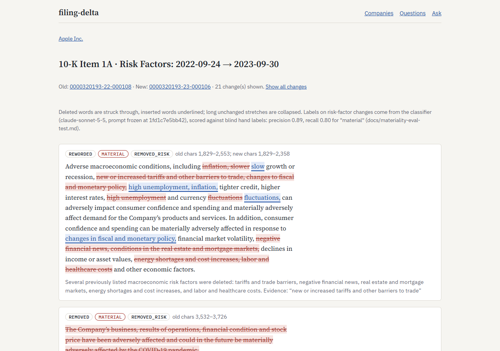
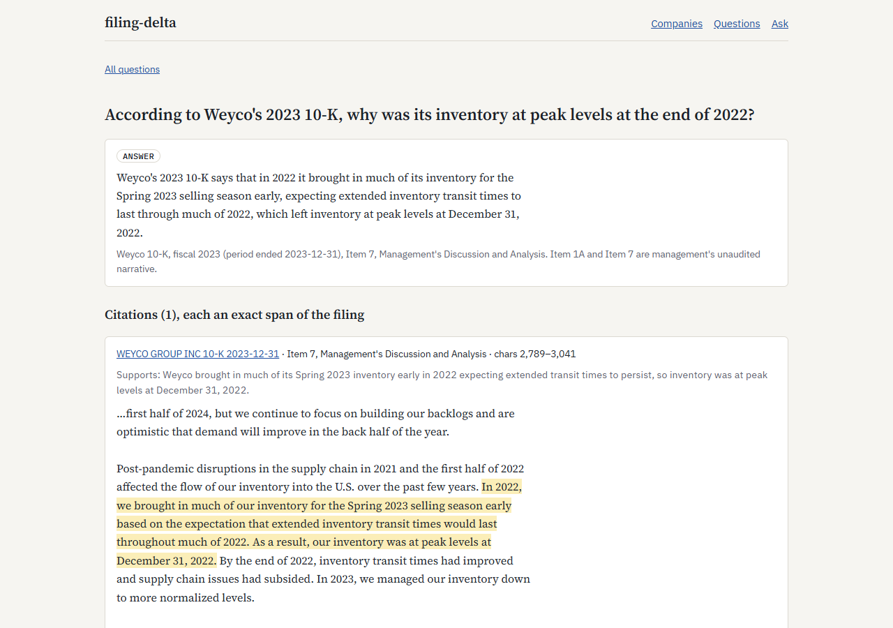

# filing-delta

[](https://github.com/tjromack/filing-delta/actions/workflows/clean-clone.yml)

**See what a company newly disclosed, quietly dropped, or materially reworded between filings — with every claim
traceable to the exact span it came from.**

> **Status:** built and verified through M8. Ingestion, section parsing, the diff, the material/cosmetic classifier,
> the XBRL join, grounded QA and its `spancheck` evaluation are done; every number below reproduces from a clean
> clone with no API key (see *Quickstart*). Remaining: the Build 4 export and the case study (`TODO.md`).

## What it does

1. **Fetches** 10-K, 10-Q and 8-K filings from SEC EDGAR, honoring EDGAR's fair-access rules: a declared
   User-Agent, a rate limit, and a local cache so a re-run makes zero requests.
2. **Parses** the narrative sections (Item 1A Risk Factors, Item 7 MD&A) out of decades of inconsistent filer HTML.
   Every parse failure is logged and counted, never skipped silently.
3. **Diffs** each section period over period at paragraph level: added, removed, reworded, moved. This step is
   **fully deterministic and uses no model.**
4. **Classifies** each change as *material* or *cosmetic*. This is the only model judgment in the diff, and it is
   scored against hand labels.
5. **Answers questions** over the corpus with span-level citations. When the answer isn't in the filings, it
   **abstains**. Every answer either cites an exact span or declines.

## Who it's for

Anyone who has to read the same company's risk factors year after year and wants to know what *changed*: analysts,
compliance and audit reviewers, researchers. It's also for engineers who want a worked example of separating
deterministic processing from model judgment, and scoring the model half.

## What it does not do

- **It is not investment advice.** It reports what filings say and how the text changed. It makes no judgment about
  what that means for a security, and nothing it outputs is forward-looking.
- **It doesn't verify what management says.** Item 1A and Item 7 (MD&A) are unaudited management narrative,
  and MD&A figures are often non-GAAP. The tool shows what the text says and how it changed, not whether it is
  accurate. Only the audited financial statements carry that weight. The one exception is narrow: MD&A sentences
  stating a whole-company headline figure (revenue, net income, operating income, operating cash flow, diluted EPS)
  for the filing's own period are compared with the same filing's tagged statement value. About 18% of such
  claims can be checked this way; the rest are about segments or other periods (`docs/claims-report.md`).
- **It can't prove something is absent.** Asked "does the 10-K discuss X?", it may answer "the sections searched
  don't say X; they do say Z", quoting Z. Before it says so it searches again for other wording, but a search can
  still miss text phrased differently, so read "doesn't say" as "wasn't found". It never gives that kind of answer
  to a question asking for a specific figure; those are refused.
- **Its accuracy figures are agreement with a model-built answer key.** The QA key comes from two models that
  agreed on 58 of 60 questions, with a human deciding the other 2. That is not an independent human measurement
  (FD-DEC 031); the material/cosmetic classifier's figures are against blind human labels.
- **It doesn't claim financial-analysis expertise.** "Material" here is a labeled text-change category, not a legal
  or accounting materiality determination. The classifier's weakest calls are "cosmetic" on restructured passages
  and "material" on figure-only updates (`docs/materiality-error-analysis.md`).
- **It doesn't cover anything outside its ingested corpus.** Coverage: **10-K** with a period of report from 2018-01-01 to
  2025-12-31, and **10-Q** filed 2025-01-01 to 2026-09-30, for **11 companies** (`corpus.toml`; every accession in
  `corpus/manifest.csv`). Amendments are excluded. Questions outside that range get an abstention.
- It doesn't parse exhibits, financial statements or XBRL tables as narrative. XBRL facts are joined as context
  only, always labeled as coming from the 10-K's audited statements or the 10-Q's unaudited interim statements.

## Quickstart

Reproduce every published number from a fresh clone, with no API key (about 8 minutes):

```
git clone https://github.com/tjromack/filing-delta.git && cd filing-delta
uv sync --extra dev
uv run python tools/fetch_release.py     # the data release: EDGAR responses + recorded model responses (63 MB)
uv run python tools/reproduce.py         # rebuild, re-run every evaluation, fail if any report changes by a byte
```

`fetch_release.py` uses the GitHub CLI (`gh`) and checks the download against `release/manifest.json` before
unpacking. `reproduce.py` blanks `ANTHROPIC_API_KEY`, so every model output comes from the recorded responses. The
same run happens on a fresh Linux runner on every push (`.github/workflows/clean-clone.yml`).

Then browse it:

```
uv run filing-delta serve                # http://127.0.0.1:8000
```

The read view shows each company's filings compared period over period: inserted and deleted words, the
material/cosmetic label with its reason and evidence, and the exact character span and SEC.gov link for every
change. It also shows the 60 recorded questions with every citation highlighted in its filing. With
`ANTHROPIC_API_KEY` set, **Ask** answers a new question through the frozen pipeline.





To fetch the corpus yourself instead (about 250 requests at SEC's fair-access rate), set `EDGAR_USER_AGENT="Your
Name you@example.com"` in `.env` and run `uv run filing-delta fetch`, then `parse`, `diff`, `facts`, `claims`.

## How it's verified

| Check | What it proves | Result |
|---|---|---|
| Golden-file parser tests | Section boundaries are found correctly across filers and HTML eras | 28 sections / 14 filings, every archetype and HTML era, each boundary confirmed by hand against the filing (`docs/golden-review.md`) |
| Published parse-success rate + failure log | Parse failures are surfaced, not hidden | 270 of 272 present sections `ok` (99.3%), 16 verified-absent, 2 failed (exhibit incorporation): `docs/parse-report.md` |
| Diff tests + human-labeled alignment | The diff is deterministic, and "reworded" vs "removed + added" matches human judgment | 17 mutation-checked unit tests; re-diffs byte-identical. Against 70 blind, stratified human labels: precision 0.83 (95% CI 0.74–0.93), recall 0.80 (0.66–0.93): `docs/alignment-eval.md` |
| Material/cosmetic confusion matrix vs. hand labels | How good the model judgment is, and where it's wrong | 122 blind, stratified human labels, scored once with a frozen prompt: agreement 77%, "material" precision 0.89 (95% CI 0.81–0.96), recall 0.80 (0.68–0.89): `docs/materiality-eval-test.md`. Error analysis: `docs/materiality-error-analysis.md`. All 5,623 corpus changes classified by two models (77.0% agreement): `docs/materiality-corpus.md` |
| XBRL facts join, two independent sources | Financial-statement values are extracted and tied to the right filing and period | Inline XBRL read from each filing vs. the SEC company-facts API: 65,243 of 65,243 values equal; 0 extraction issues; 132/132 document period ends match EDGAR. 44 mutation-checked tests (52/53-week years, January fiscal year ends, year-to-date-only cash flow): `docs/xbrl-report.md` |
| MD&A headline claims vs. tagged values | Whole-company figures stated in MD&A agree with the filing's own statements | No model. Of 1,085 headline claims, 194 match, 1 has no matching tagged value, 12 use non-GAAP wording, 878 can't be checked (segments, other periods). 21 mutation-checked rule tests. Hand check: 100 claims labeled with the matcher's answer shown, 0 of 99 overridden at ~5 s each, so it is not independent evidence (FD-DEC 026): `docs/claims-eval.md` |
| Cite-or-abstain verifier + QA run | No answer is shown without an exact-span citation; it abstains when the filings don't answer | 16 forged-citation tests (fabricated, altered, wrong offsets, wrong filing, one bad citation among good), all mutations caught. On 60 questions (pipeline v4): 37/37 answerable questions answered, every one citing the key's passage; 23/23 correct abstentions (13 by scope rule, 8 by the model, 2 figure questions withheld by rule); 37/37 answers' citations verified exact; retrieval recall 37/37 (with the second search before any "doesn't say" answer). **The answer key is model-built** (two-model jury, Trevor decided their 2 disagreements): `docs/qa-eval.md` |
| `spancheck` citation + abstention report | Answers cite real spans and abstain when they should | `spancheck` 0.3.1 on the recorded v4 run: provenance 91/91 citations; abstention 60/60; **answer entailed by its own citations 59/60** (the exception is a "doesn't say" answer, whose absence half no quote can prove); per-citation support 88% (judged); answer entailed by retrieved passages 97%. p50 latency 2.9 s, p95 4.2 s; $0.45 per 60 questions; same decision on a re-run 60/60. Key is model-built: `docs/spancheck-report.md` |
| Clean-clone reproduction | Every number here comes from the code and data in this repo, not from one machine | On a fresh Linux runner, with no API key, `tools/reproduce.py` rebuilds everything from the data release and re-runs every evaluation; every committed report and golden file regenerates byte for byte (`.github/workflows/clean-clone.yml`, on every push) |
| Simulated 429 storm | The EDGAR client backs off and recovers without breaking fair access | Passing (`tests/test_edgar_client.py`); warm re-run of the full corpus = 0 requests |

## Data

All inputs are **public SEC EDGAR filings**. No private, client or personal data is used. EDGAR's fair-access
policy is followed: a declared User-Agent, a rate ceiling below SEC's limit, and cached responses.

## License

MIT. See `LICENSE`.
